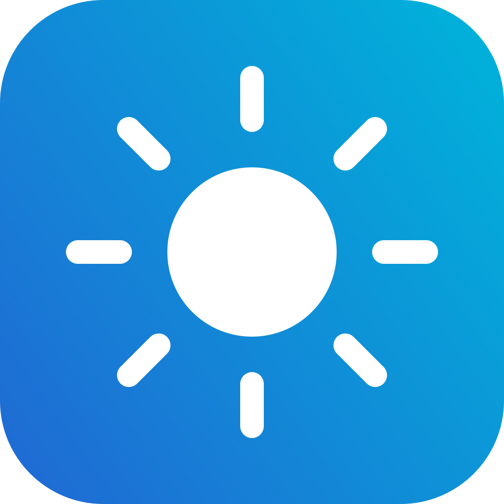

<div align="center">
  
  <h1>Brillo Rápido</h1>
  <p>El brillo de todas tus pantallas, a un clic desde la barra de menús.</p>
  <p><strong>App local para macOS 15 o posterior</strong></p>
</div>

---

Brillo Rápido es una pequeña app de barra de menús para ajustar enseguida el brillo de la pantalla integrada del Mac y de los monitores conectados. No tiene ventana en el Dock: abre sus controles al pulsar el icono del sol.

## Qué puedes hacer

- Cambiar el brillo de todas las pantallas o ajustar cada una por separado.
- Usar los botones `−` y `+` para cambiar en pasos de 5 puntos porcentuales, o el deslizador para afinar de uno en uno.
- Ver qué método está usando cada pantalla: brillo físico del Mac, DDC/CI del monitor o atenuación visual.
- Actualizar la lista de pantallas al instante. La app también la refresca al conectar o desconectar una pantalla, al volver de reposo y al abrir los controles.

El control de **Todas las pantallas** muestra el promedio de las pantallas que se pueden ajustar. Mover su deslizador fija ese mismo porcentaje en cada una; los botones `−` y `+` suben o bajan cada pantalla en 5 puntos.

## Cómo controla cada pantalla

| Pantalla o método | Qué cambia | Cuándo se usa |
| --- | --- | --- |
| Pantalla integrada del Mac | El brillo físico del panel | Mediante `DisplayServices`, un framework privado de macOS |
| Monitor externo con DDC/CI | El brillo físico del monitor | Cuando el monitor y la conexión permiten comunicarse con él |
| Atenuación visual | Una capa oscura sobre la imagen | Si no se puede cambiar el brillo físico, algo que puede ocurrir por HDMI o por falta de DDC/CI |

La atenuación visual no modifica la retroiluminación del monitor. Es una capa transparente que se puede quitar; desaparece automáticamente al salir de la app. Si el monitor ofrece una opción **DDC/CI**, actívala en su menú y pulsa actualizar en Brillo Rápido para volver a intentar el control físico.

## Instalar y abrir

El código de este repositorio crea la app localmente; no incluye una app precompilada ni un instalador.

1. Descarga o clona el repositorio en un Mac con macOS 15 o posterior.
2. Abre Terminal dentro de `BrilloRapido/` y ejecuta:

   ```sh
   ./build.sh
   ```

3. Abre `BrilloRapido.app`, que se crea en esa misma carpeta.

También puedes indicar dónde guardar la app:

```sh
./build.sh "$HOME/Applications/BrilloRapido.app"
```

La compilación requiere las herramientas de desarrollo de Apple: `swiftc`, `clang` y `codesign` (incluidas en Xcode o en las herramientas de línea de comandos de Xcode). El script compila la app Swift, compila el ayudante DDC y firma ambos localmente con firma ad hoc. No notariza la app. Si macOS bloquea una copia compilada localmente, usa Finder para hacer clic derecho sobre ella y elegir **Abrir**.

## Qué incluye el código

- **Interfaz:** app de barra de menús y controles hechos con SwiftUI y AppKit.
- **Detección:** identificación de las pantallas activas y sus nombres con APIs de macOS.
- **Brillo del Mac:** acceso dinámico a los símbolos de `DisplayServices` para que la app pueda seguir abriendo aunque cambien en una futura versión de macOS.
- **Monitores externos:** el proyecto incluye [`m1ddc`](https://github.com/waydabber/m1ddc) en la revisión `7339ceebb03f691b1eaeb8471dca301d215d19c8` y lo compila como un ayudante local. Se adaptó la salida del ayudante para que la app pueda leer las respuestas; la app le pasa el identificador de pantalla y el nivel de brillo.
- **Compatibilidad:** cuando el control físico no está disponible, una ventana transparente, sin bordes y que ignora los clics atenúa la pantalla sin bloquear su uso.

No se instala ningún servicio en segundo plano. No hay preferencias persistentes: los ajustes de atenuación visual viven mientras la app está abierta y se limpian al salir.

## Privacidad y límites

La app funciona localmente. El código no incluye inicio de sesión, conexión a servidores, analítica ni telemetría. Se comunica con las pantallas mediante frameworks de macOS y DDC/CI.

El control de `DisplayServices` usa una API privada y podría dejar de funcionar si Apple la cambia. La compatibilidad con DDC/CI depende del monitor, el cable, el adaptador y macOS; HDMI no siempre permite controlar físicamente el brillo. En esos casos, la app indica que está usando atenuación visual.

## Licencias

El código de `m1ddc` incluido en `ThirdParty/m1ddc` conserva la licencia MIT y el aviso de copyright de su autor. Esa licencia cubre ese componente; **este repositorio no asigna por ahora una licencia al resto de Brillo Rápido**. La licencia MIT de `m1ddc` no se extiende automáticamente a la app.
